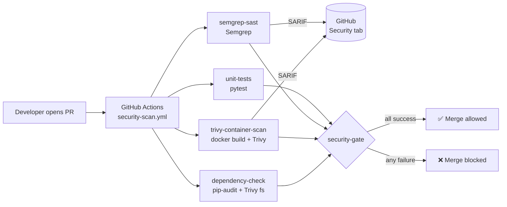

# DevSecOps CI/CD Security Pipeline

[](https://github.com/Gav-debug8888/devsecops-cicd-security/actions/workflows/security-scan.yml)
[](https://semgrep.dev)
[](https://trivy.dev)
[](https://github.com/pypa/pip-audit)

A GitHub Actions **security gate** that **blocks pull requests** when it finds high or critical issues in code, containers or dependencies. It protects a small Flask inventory API. The pipeline is the real product here.

| Layer | Tool | What it catches | Blocks on |
|-------|------|-----------------|-----------|
| SAST | **Semgrep** (`--config=auto`) | SQL injection, XSS, hard-coded secrets, insecure Flask settings | `ERROR` severity (high/critical) |
| Container | **Trivy** image scan | OS and library CVEs in the Docker image | `HIGH`, `CRITICAL` (fixable) |
| SCA | **pip-audit** + Trivy fs | Known CVEs in `requirements.txt` | Any known CVE / `HIGH`, `CRITICAL` |
| Quality | **pytest** | Regressions, including security unit tests | Any failure |
| Gate | `security-gate` job | Aggregates everything above | Any job not `success` |

## Pipeline architecture



## How the security gate works

1. **Trigger.** Every `pull_request` targeting `main`, and every `push` to `main`, starts `security-scan.yml`.
2. **Parallel scans.** Four jobs run at the same time to keep feedback fast (usually 2–4 minutes):
   - `semgrep-sast` runs Semgrep twice. A full scan writes SARIF for the Security tab. A second scan uses `--severity=ERROR --error` and exits non-zero on high or critical findings.
   - `trivy-container-scan` builds the image, uploads a full SARIF report, then runs the equivalent of `trivy image --exit-code 1 --severity HIGH,CRITICAL`.
   - `dependency-check` runs `pip-audit --strict` and a Trivy filesystem scan of `requirements.txt`.
   - `unit-tests` runs pytest, including tests for SQL injection resistance, input validation and security headers.
3. **No soft failures.** Every job sets `continue-on-error: false`. Scans that only produce reports use `|| true` or `exit-code: 0`. Only the explicit gate steps can fail a job.
4. **Aggregation.** `security-gate` uses `needs:` with `if: always()`, so it runs even when an upstream job fails. It reads every result, writes a summary table to the run page, and exits `1` if anything did not succeed.
5. **Enforcement.** Branch protection requires the **Security Gate** check. Without it, a failing pipeline is only a warning.

## Enforce the gate with branch protection

The workflow alone does not stop a merge. GitHub only blocks merging when the check is **required**.

**Option A: Rulesets (recommended)**
1. Go to **Settings → Rules → Rulesets → New ruleset → New branch ruleset**.
2. Name it `protect-main` and set **Enforcement status** to *Active*.
3. Under **Target branches**, choose **Add target → Include default branch**.
4. Enable:
   - ✅ **Require a pull request before merging** (1 approval, dismiss stale approvals)
   - ✅ **Require status checks to pass** → add **`Security Gate`**. Tick *Require branches to be up to date before merging*.
   - ✅ **Block force pushes**
5. Leave **Bypass list** empty so admins cannot skip the gate.
6. Click **Create**.

**Option B: Classic branch protection**
**Settings → Branches → Add branch protection rule** → pattern `main` → *Require status checks to pass before merging* → search for and select `Security Gate` → enable *Do not allow bypassing the above settings*.

> The check only appears in the search box after the workflow has run at least once. Push a commit or run it manually from the Actions tab first.

**Optional: GitHub CLI**
```bash
gh api -X PUT repos/Gav-debug8888/devsecops-cicd-security/branches/main/protection \
  --input - <<'EOF'
{
  "required_status_checks": { "strict": true, "contexts": ["Security Gate"] },
  "enforce_admins": true,
  "required_pull_request_reviews": { "required_approving_review_count": 1 },
  "restrictions": null
}
EOF
```

## Example: a blocked PR

[`docs/scan-results-example.md`](docs/scan-results-example.md) walks through a PR that adds a SQL-injectable search endpoint and an outdated base image:

- Semgrep flags `python.lang.security.audit.formatted-sql-query` (ERROR) → **job fails**
- Trivy finds a HIGH-severity OpenSSL CVE in the image → **job fails**
- `Security Gate` → ❌ **Merge blocked** until both are fixed

## Run locally

```bash
# App
export API_TOKEN="$(python -c 'import secrets; print(secrets.token_urlsafe(32))')"
docker compose up --build        # http://127.0.0.1:8000/health

# Same checks as CI
pip install -r requirements.txt pytest semgrep pip-audit
pytest -q
semgrep scan --config=auto --severity=ERROR --error
pip-audit -r requirements.txt --strict
docker build -t inventory-api:local .
trivy image --exit-code 1 --severity HIGH,CRITICAL --ignore-unfixed inventory-api:local
```

## API

| Method | Path | Auth | Description |
|--------|------|------|-------------|
| GET | `/health` | none | Liveness check |
| GET | `/items?q=` | none | List and search items (parameterised `LIKE`) |
| GET | `/items/<id>` | none | Get one item |
| POST | `/items` | Bearer `API_TOKEN` | Create `{ "name": str(1-100), "quantity": int>=0 }` |
| DELETE | `/items/<id>` | Bearer `API_TOKEN` | Delete an item |

## Repository layout
```
├── app.py                         # Flask inventory API
├── Dockerfile / docker-compose.yml  # non-root, read-only, cap_drop ALL
├── .semgrepignore
├── .github/workflows/
│   ├── security-scan.yml          # main blocking gate
│   ├── trivy-scan.yml             # manual Trivy fs + image scan with summary table
│   └── semgrep-scan.yml           # standalone Semgrep action + SARIF
├── docs/
│   ├── pipeline-overview.md       # deep dive, tool choice, tuning, false positives
│   └── scan-results-example.md    # blocked-PR walkthrough
└── tests/test_app.py
```

## Related projects
- **Fintech-Threat-Model**: STRIDE, ATT&CK and Kill Chain threat model
- **devsecops-vulnerable-app**: the kind of code this gate is designed to stop
- **secure-task-api**: a production-style FastAPI app that reuses this pipeline pattern
